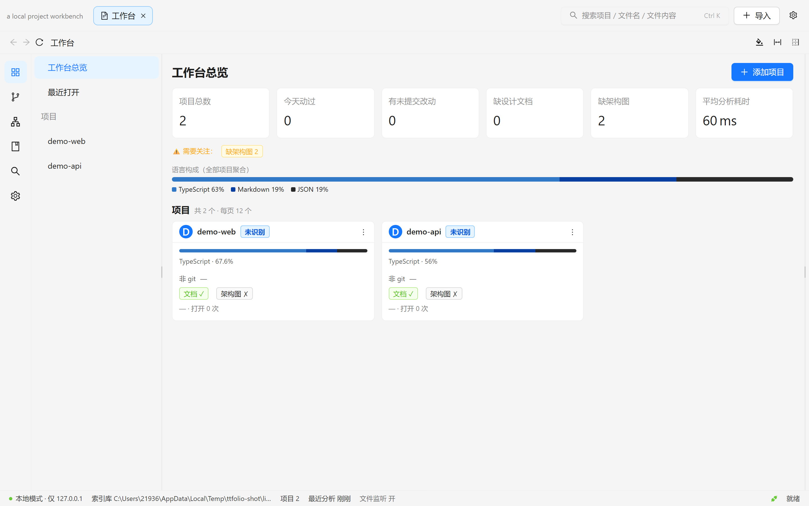
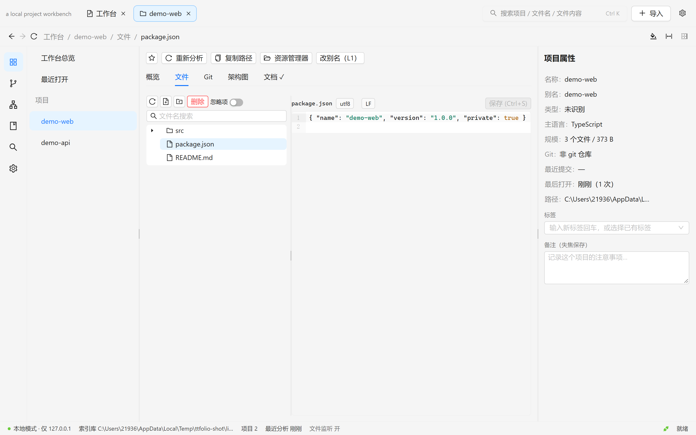
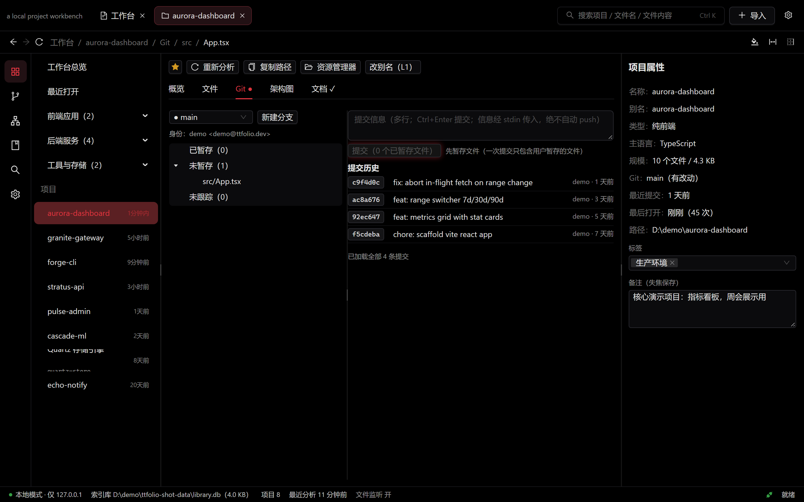
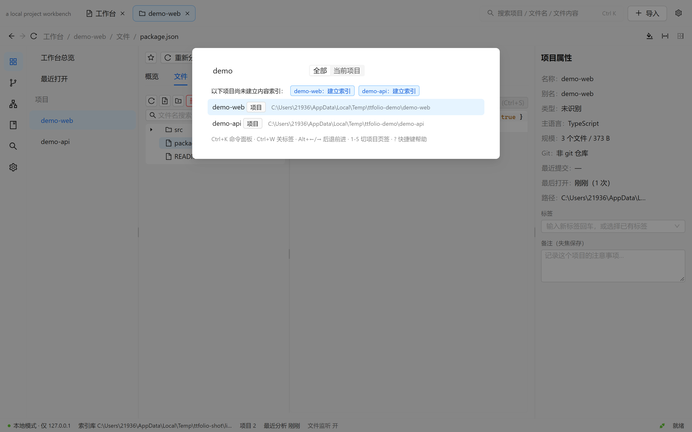

<div align="center">

# ttFolio

**本地的项目工作台** · a local project workbench

简体中文 | [English](README.en.md)

[](LICENSE)
[](../../releases)
[](CHANGELOG.md)

</div>

ttFolio 把硬盘上的项目文件夹登记进同一个界面：浏览代码、查看 Git、管理文档与架构图、全局搜索。

## 特性

- **项目登记与分析** —— 粘贴路径 / 文件夹对话框 / 父目录批量登记；自动识别项目类型、语言占比（Linguist 口径）、技术栈与 Git 摘要
- **文件浏览与编辑** —— 懒加载文件树、CodeMirror 6、草稿保护、外部修改检测、保存冲突三选一；UTF-8/BOM/UTF-16/GBK 与 CRLF/LF 原样保持
- **文件操作** —— 右键菜单（复制 / 移动 / 重命名 / 路径复制 / 资源管理器定位）、面包屑逐级定位；删除一律进回收站，可恢复原路径
- **Git** —— 工作区状态、diff、暂存、提交、历史与详情、分支切换；不做 push/pull，不存储凭据
- **文档与架构图** —— Markdown 自动发现与渲染、外部文档挂载、架构图目录内 HTML / 图片 / 文本分栏预览（独立只读端口 + iframe 沙箱）
- **搜索** —— Ctrl+K 命令面板；项目名 / 文件名 / 文件内容三档搜索（SQLite FTS5，中文友好，增量索引）
- **集合 · 标签 · 视图** —— 项目归类与折叠浏览、标签与备注、按标签过滤视图、卡片墙 / 表格视图、失效项目一键重新定位
- **工作台总览** —— KPI 一览、需要关注的项目、聚合语言构成、跨项目最近提交
- **主题** —— 浅色 / 深色 / 电红色发光（OLED 纯黑 + 红色光晕）/ 赛博朋克（霓虹青光晕）/
  极简手绘（纸面质感）/ 跟随系统；窗口标题栏同步变色
- **桌面版** —— Electron + NSIS 安装包，进程内服务端，原生文件对话框，内置检查更新

## 界面

工作台总览（浅色默认）：KPI、聚合语言构成、集合与「最后打开」时间：



文件浏览与编辑（电红色发光主题）：懒加载文件树、CodeMirror 6、标签与备注：



Git：工作区状态与提交历史（不做 push/pull，不存储凭据）：



命令面板（Ctrl+K）：项目 / 文件 / 内容三档搜索，FTS5 中文友好，命中高亮：



## 下载

从 [Releases](../../releases) 下载 `ttFolio-Setup-x.y.z.exe`。

- Windows 10/11 x64，无需 Node.js 或其他运行环境
- 安装目录自定义（支持中文路径），无需管理员权限
- 数据保存在 `%APPDATA%\ttFolio\`，卸载不删数据
- 安装包未签名：SmartScreen 提示时选择「更多信息 → 仍要运行」；首次启动可能被杀软全量扫描（约 1 分钟），二次启动 4 秒内

## 从源码运行

需要 Node.js ≥ 22。Git 可选（缺失时 Git 页签不可用，其余正常）。

```bash
npm install
npm run dev        # 后端 127.0.0.1:7717 + 前端 localhost:5173
```

| 命令 | 说明 |
| --- | --- |
| `npm run dev` | 开发模式（Vite + Fastify 热重载） |
| `npm run typecheck` | TypeScript 严格检查（shared / server / web 三包） |
| `npm run lint` | ESLint，0 警告容忍 |
| `npm run test` | Vitest 单元与集成测试（真实 SQLite / git 夹具） |
| `npm run build` | 生产构建 |
| `npm run dist:win` | 打包 Windows 安装包（含产物自检） |

> 打包后本机 `node_modules` 中的 better-sqlite3 为 Electron ABI，继续开发前先 `npm rebuild better-sqlite3`。

## 反馈

欢迎提交 [Issue](../../issues) 反馈问题与建议。

## 许可证

[MIT](LICENSE) © TT-Tao178
